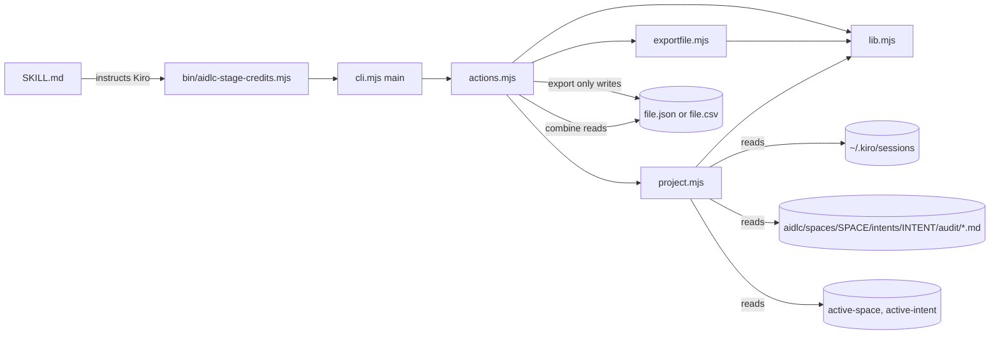
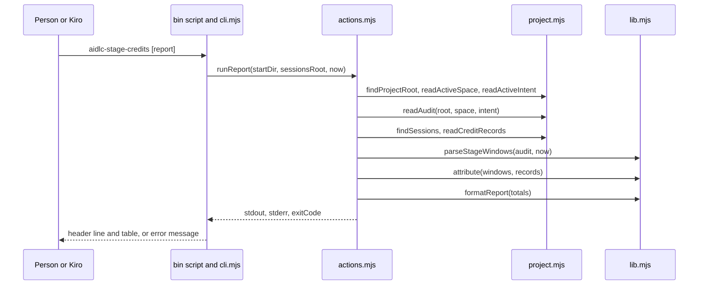
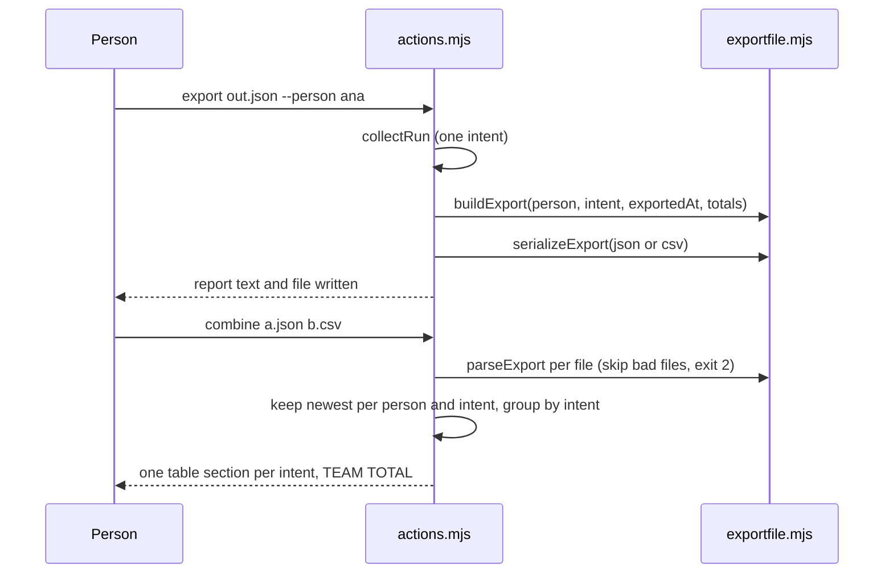

## Architecture Analysis

### System Overview
A small local, read-only command-line tool plus a Kiro skill file. Layers: a bin script prints and sets the exit code; `cli.mjs` parses arguments; `actions.mjs` runs the three actions; `project.mjs` reads the project, audit and Kiro files; `lib.mjs` and `exportfile.mjs` hold pure logic. No server, network or database. Only `export` writes a file, the one the person names.

### Architectural Style
Layered functional core with an imperative edge. Evidence: `lib.mjs` and `exportfile.mjs` do no file access; `project.mjs` is the only reader (read-only); `actions.mjs` returns `{stdout, stderr, exitCode}` and never prints or exits; only `bin/aidlc-stage-credits.mjs` prints and ends the process (BR6.3).

### Component Relationships

Text fallback: the skill tells Kiro to run the bin script; it calls `cli.mjs`, which calls `actions.mjs`. Actions use `project.mjs` to read the active space, active intent, audit files and Kiro sessions, `lib.mjs` to parse and attribute, and `exportfile.mjs` to build and read export files. `export` writes one file; `combine` reads export files.

### Data Flow
The report path (`collectRun` in `src/actions.mjs`), one intent:
1. `findProjectRoot` (walk up to a folder holding `aidlc/`), `readActiveSpace` (`aidlc/active-space`, default `default`), `readActiveIntent` (`intents/active-intent` file text, trimmed).
2. `readAudit`: every `*.md` in `intents/<intent>/audit/`, sorted, joined with `\n---\n`.
3. `findSessions`: sessions under `<sessionsRoot>/<workspace>/<session>/session.json` whose `workspacePaths` or `rootPaths` equal the project root; `readCreditRecords` parses each `messages.jsonl`.
4. `parseStageWindows(audit, now)` builds windows; `attribute(windows, records)` sums credits per stage, remainder to "outside a stage"; `formatReport` renders the table.
5. `export`: `buildExport` plus `serializeExport` (JSON or CSV by file ending). `combine`: `parseExport` per file, newest export kept per (person, intent), one section per intent.

### Key Design Decisions
- Kiro's own records are the credit source (not an estimate).
- Attribution by timestamp, half-open `start <= t < end`; the latest-starting window wins; a re-entered stage is a new window and its credits are summed per stage name.
- Session matching by project path only; sessions carry no intent, so intent attribution rests entirely on the audit windows.
- No dependencies, plain Node ESM; every function takes its folders as input so tests use temp folders.

### Improvement Opportunities
For multi-intent use: enumerate intents (from `intents.json` or the intent folders) instead of reading only `active-intent`, build windows per intent, and define how credits that fall in no intent's window, or in two, are shown. Details: code-quality-assessment.md.

## Interaction Diagrams

Text fallback: the person runs the command; the CLI layer calls `runReport`, which finds the project, the active space and intent, reads that intent's audit and the project's sessions, builds windows, attributes credits, formats the table and returns the text and exit code for the bin script to print.

Text fallback: export runs the single-intent run, builds the export object and writes JSON or CSV; combine parses each file, drops unusable ones with a warning, keeps the newest export per person and intent, and prints one section per intent.
