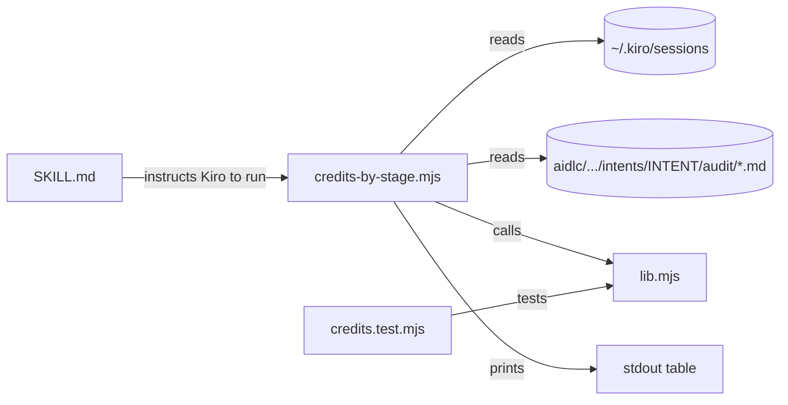
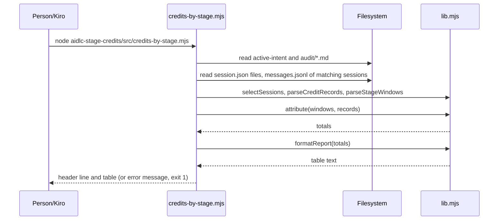

## Architecture Analysis

### System Overview
A small local, read-only command-line tool plus a Kiro skill file. A pure logic module (`lib.mjs`) is driven by one entry script that does all file access. There is no server, network or database.

### Architectural Style
Single-process script with a functional core and an imperative shell. Evidence: `lib.mjs` has no I/O ("Pure logic ... No file or network access"); `credits-by-stage.mjs` does all reads at module top level.

### Component Relationships

Text fallback: SKILL.md tells Kiro to run the CLI; the CLI reads Kiro sessions and the audit files, calls lib.mjs, and prints a table; the tests cover lib.mjs only.

### Data Flow
1. Read `active-intent`, then every `*.md` in that intent's `audit/`; join with `---`.
2. List `~/.kiro/sessions/<workspace>/<session>/session.json`; keep sessions whose `workspacePaths` equals the cwd.
3. Read each kept session's `messages.jsonl`; extract credit records.
4. `parseStageWindows` builds windows; `attribute` sums credits per stage; `formatReport` renders text.

### Key Design Decisions
- Kiro's own records are the credit source (not an estimate).
- Attribution by timestamp window, half-open `start <= t < end`; the latest-starting window wins; re-entered stages are summed.
- No dependencies, plain Node ESM.
- Read-only toward Kiro's and AI-DLC's files.

### Improvement Opportunities
Move I/O into testable functions; resolve the active space instead of `default`; add a format guard for Kiro records; package as an extension. Details in code-quality-assessment.md.

## Interaction Diagrams

Text fallback: the person runs the script; it reads the audit and session files, uses lib.mjs to select sessions, parse records and windows, attribute credits and format the table, then prints it, or prints an error and exits 1.
