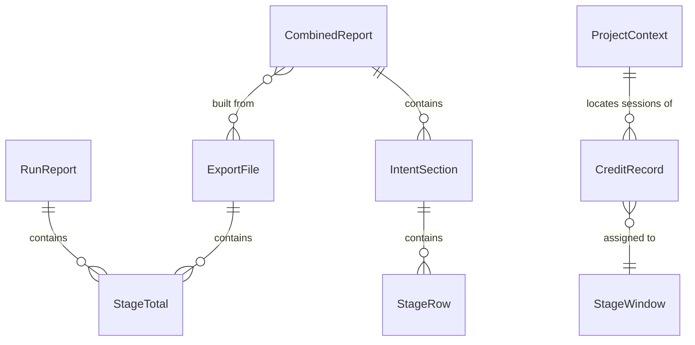

# Functional Specification

Inputs: `requirements.md` (FR1 to FR7, NFR1, NFR2), the code knowledge base (`business-overview.md`, `architecture.md`, `code-structure.md`, `api-documentation.md`, `code-quality-assessment.md`) and the answers in `functional-design-questions.md`. The data is in `entities.md` and the decision rules in `rules.md`. There are no units of work and no user stories in this refactor plan; the existing code structure is the domain design.

## Command Line

One command, `aidlc-stage-credits`, with three actions (BR6.1):

| Action | Command | Output | Exit code |
|---|---|---|---|
| report (default) | `aidlc-stage-credits` | the per-stage table, as today; writes nothing | 0, or 1 on an error (BR2.1) |
| export | `aidlc-stage-credits export <file> [--person <name>] [--force]` | the table, and the one file named | 0, or 1 on an error (BR3.1 to BR3.3) |
| combine | `aidlc-stage-credits combine <file>...` | one section per intent, then ignored files and warnings; writes nothing | 0; 2 when any file was skipped, including when every file was (BR4.2, BR4.3); 1 when no file is named (BR4.3) |
| anything else | `aidlc-stage-credits <other>` | a usage message | 1 (BR6.1) |

"No export requested" simply means the action is report or combine: only the export action ever writes (BR3.1).

Running it from any folder inside the project works (BR1.3).

## Workflows

**Report (and the first half of export)**
1. Find the project root: start at the current folder and go up until a folder holds `aidlc` (BR1.3). Stop with a message if none.
2. Read the active space (BR1.1) and the active intent (BR1.2).
3. Read the intent's audit files; stop if there are none (BR2.1).
4. List Kiro sessions; keep the ones whose workspace path equals the project root (BR1.4); stop if none (BR2.1).
5. Read each kept session's credit records, skipping unreadable files and lines (BR2.1).
6. Work out the stage windows, assign each record to its window, and add up the totals (BR2.2).
7. Print the header line and the table.

**Export**
1. Run the report steps 1 to 6.
2. Refuse when the file name has no .json or .csv ending (BR3.2), when the person name is empty (BR3.3), or when the file exists and `--force` is absent (BR3.1).
3. Write the export file with only the allowed fields, credits at full precision (BR3.4, BR3.5).

**Combine**
1. Read each named file as an export; mark each one usable or unusable (BR4.2). No file named: stop (BR4.3).
2. Group usable exports by person and intent; keep the newest in each group and note the others as ignored (BR4.1).
3. Group the kept exports by intent (BR4.4) and, per intent, print the rows in the order BR4.6 sets, then the team total.
4. Print the ignored list and the warnings. Exit with 2 if any file was unusable.

## Export File Format

JSON (`.json`):

```
{ "format_version": 1, "tool_version": "1.0.0", "person": "ana", "intent": "261122-example",
  "exported_at": "2026-11-22T10:00:00Z",
  "stages": [ { "stage": "intent-capture", "credits": 15.674 } ], "outside": 1.378 }
```

CSV (`.csv`): the header row `format_version,tool_version,person,intent,exported_at,kind,stage,credits`, then one row per stage with `kind` set to `stage`, and one last row with `kind` set to `outside` and an empty `stage`. A field with a comma, a double quote or a line break is wrapped in double quotes with inner quotes doubled (BR3.5).

Both formats carry exactly the fields of `ExportFile` (BR3.4). Credits are written at full precision; rounding to 3 decimals happens only when a report is printed. Reading a JSON or CSV export back gives the data that was written.

## Error Handling

| Case | Result | Rule |
|---|---|---|
| no Kiro sessions folder | stop, message, exit 1 | BR2.1 |
| active intent missing or blank | stop, message, exit 1 | BR1.2 |
| no audit file | stop, message, exit 1 | BR2.1 |
| no session for the project | stop, message, exit 1 | BR2.1 |
| one session file unreadable | skip it, carry on | BR2.1 |
| messages file unreadable, or a bad line in it | skip that file or line, carry on | BR2.1 |
| no AI-DLC folder at or above the current folder | stop, message, exit 1 | BR1.3 |
| export target exists without `--force` | stop, message, exit 1 | BR3.1 |
| export file name does not end in .json or .csv | stop, message, exit 1 | BR3.2 |
| export person name is empty | stop, message, exit 1 | BR3.3 |
| unknown action | usage message, exit 1 | BR6.1 |
| combine given no files | stop, message, exit 1 | BR4.3 |
| combine file unusable (any reason in BR4.2) | skip, warn, report the rest, exit 2 at the end | BR4.2 |
| combine: every file unusable | print the warnings, no report, exit 2 | BR4.3 |

## Repeatable Figure Check

The test data is a small set of anonymized credit records (timestamp and credits only), stage windows (stage name, start, end) and an `expected` file with stage names and totals recorded by hand from Kiro's usage page (BR5.1). A test runs the tool's logic on the data and compares per-stage and total figures at 3 decimals (BR5.2). A second test fails when a record, window or expected file holds any field beyond those (BR5.1).

## Delivery and CI

- The package declares a version and that Node 22 or newer is needed, and ships `SKILL.md` and `README.md` (BR6.2).
- Every action can be run in tests with explicit folders, without the real home folder (BR6.3).
- CI runs the tests with Node 22 on every push and pull request (BR7.1).

## Entity-Relationship View (derived from entities.md)



Text fallback: a run report and an export file each contain stage totals; a combined report is built from export files and contains one section per intent; credit records are assigned to stage windows; the project context says which sessions belong to the project.

## Decisions Beyond Your Answers

These came from the requirements review and the code knowledge base, not from a question. Say if any should change.
- Node 22 or newer is the minimum, because it is the only version the tool has been run on (BR6.2).
- The test data also holds stage names (in the stage windows and the expected file), because the per-stage check needs them; they are AI-DLC stage names, not private data (BR5.1). Your answer to Q3 named only timestamps and credit values.
- Exports keep credits at full precision, so a read-back gives the same data and team totals do not drift by rounding (BR3.4).
- One command with `report`, `export` and `combine` actions (BR6.1).
- An export is never overwritten unless `--force` is given (BR3.1).
- The export format follows the file name ending, and CSV and JSON carry the same fields (BR3.2, BR3.5).
- Person names are compared exactly, so "Ana" and "ana" are two people (BR4.5).
- When two exports for a person and intent have the same time, the one whose file path sorts last counts (BR4.1).
- Exit code 2 means "ran, but some files were skipped" (BR4.2).
- In a combined report a person with no figure for a stage shows 0.000, and people are listed a to z (BR4.6).
- A warning when Kiro's record format changes (finding 4 of the code quality assessment) is not designed here; it was not asked for.

## Rules Summary (derived from rules.md)

See the table at the end of `rules.md`.
